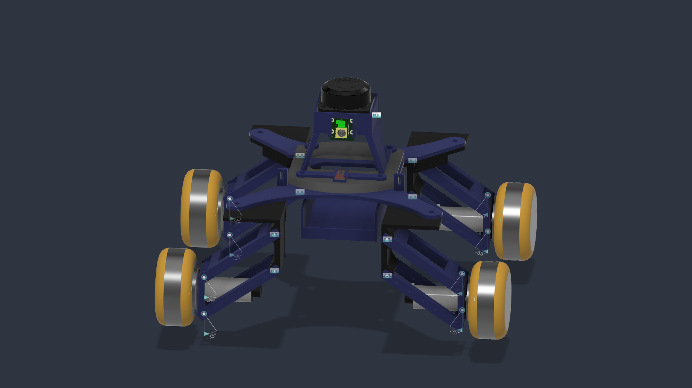

# Land_V2_Assembly — Robot Description



## Overview

| Property | Value |
|----------|-------|
| Total mass | 11.854 kg |
| Links | 8 |
| Joints | 7 (4 movable) |
| Assemblies | 8 |
| Root link | `base_link` |

## Table of Contents

- [Kinematic Tree](#kinematic-tree)
- [Link Properties](#link-properties)
- [Joint Properties](#joint-properties)
- [Assembly Breakdown](#assembly-breakdown)
- [Quick Start (ROS 2)](#quick-start-ros-2)
- [Files](#files)

## Kinematic Tree

```
base_link [BAKE]
  └─ lidar_joint [fixed]
    lidar_link
  └─ imu_joint [fixed]
    imu_link
  └─ camera_joint [fixed]
    camera_link
  └─ front_right_wheel_joint [continuous]
    front_right_wheel [BAKE]
  └─ back_right_wheel_joint [continuous]
    back_right_wheel [BAKE]
  └─ back_left_wheel_joint [continuous]
    back_left_wheel [BAKE]
  └─ front_left_wheel_joint [continuous]
    front_left_wheel [BAKE]
```

## Link Properties

| Link | Mass (kg) | Material | Collision | Bodies |
|------|-----------|----------|-----------|--------|
| `back_left_wheel` | 1.4923 | Steel | box | 1 |
| `back_right_wheel` | 1.4923 | Steel | box | 1 |
| `base_link` | 5.0697 | Steel | box | 1 |
| `camera_link` | 0.0085 | Steel | box | 1 |
| `front_left_wheel` | 1.4923 | Steel | box | 1 |
| `front_right_wheel` | 1.4923 | Steel | box | 1 |
| `imu_link` | 0.0018 | Steel | box | 1 |
| `lidar_link` | 0.8047 | Steel | cylinder | 1 |

## Joint Properties

| Joint | Type | Parent → Child | Axis | Limits |
|-------|------|---------------|------|--------|
| `back_left_wheel_joint` | continuous | `base_link` → `back_left_wheel` | (0,0,1) | — |
| `back_right_wheel_joint` | continuous | `base_link` → `back_right_wheel` | (0,0,1) | — |
| `camera_joint` | fixed | `base_link` → `camera_link` | (0,0,1) | — |
| `front_left_wheel_joint` | continuous | `base_link` → `front_left_wheel` | (0,0,1) | — |
| `front_right_wheel_joint` | continuous | `base_link` → `front_right_wheel` | (0,0,1) | — |
| `imu_joint` | fixed | `base_link` → `imu_link` | (0,0,1) | — |
| `lidar_joint` | fixed | `base_link` → `lidar_link` | (0,0,1) | — |

## Assembly Breakdown

### Camera_module_3_std_model_simple

- **Links**: 
- **Total mass**: 0.000 kg

### Land_V2_Assembly

- **Links**: imu_link, lidar_link
- **Total mass**: 0.807 kg

### Mecanum_Wheel_Assembly

- **Links**: front_right_wheel, back_right_wheel, front_left_wheel, back_left_wheel
- **Total mass**: 5.969 kg

### Pins

- **Links**: 
- **Total mass**: 0.000 kg

### Shapes

- **Links**: camera_link
- **Total mass**: 0.009 kg

### Suspension_Subassembly

- **Links**: 
- **Total mass**: 0.000 kg

### Symbols

- **Links**: 
- **Total mass**: 0.000 kg

### body

- **Links**: base_link
- **Total mass**: 5.070 kg

## Quick Start (ROS 2)

```bash
# 1. Copy package to your ROS 2 workspace
cp -r Land_V2_Assembly_description ~/ros2_ws/src/

# 2. Build
cd ~/ros2_ws
colcon build --packages-select Land_V2_Assembly_description
source install/setup.bash

# 3. Visualize in RViz2
ros2 launch Land_V2_Assembly_description display.launch.py

# 4. Validate URDF structure
check_urdf install/Land_V2_Assembly_description/share/Land_V2_Assembly_description/urdf/Land_V2_Assembly.urdf

# 5. Print kinematic tree
urdf_to_graphviz install/Land_V2_Assembly_description/share/Land_V2_Assembly_description/urdf/Land_V2_Assembly.urdf
```

**Joint control**: The launch file includes `joint_state_publisher_gui` —
use the sliders to move revolute/prismatic joints in RViz2.

**Topic inspection**:
```bash
# See published joint states
ros2 topic echo /joint_states

# See robot description parameter
ros2 param get /robot_state_publisher robot_description
```

## Files

| Path | Description |
|------|-------------|
| `urdf/Land_V2_Assembly.urdf.xacro` | Top-level xacro (entry point) |
| `urdf/Land_V2_Assembly.urdf` | Flat URDF (for validation) |
| `urdf/assemblies/` | Per-assembly xacro macros |
| `meshes/` | Visual (OBJ) and collision (STL) meshes |
| `launch/display.launch.py` | Launch robot_state_publisher, RViz, and generated controllers |
| `config/joint_state.yaml` | Joint state publisher config |
| `config/ros2_controllers.yaml` | Generated ros2_control controller manager config |
| `robot_data.yaml` | Supplementary data (beyond URDF) |
| `docs/transforms.md` | Transformation matrices (KaTeX) |

## Customizing

Assemblies tagged `!dummy_` are designed to be swapped out. To replace one:

1. Create your replacement as a xacro macro with the same interface
2. Place it in `urdf/assemblies/`
3. Update the `<xacro:include>` in `urdf/Land_V2_Assembly.urdf.xacro`
4. Update meshes in `meshes/<your_assembly>/`

The xacro prefix system (`${prefix}`) ensures link names stay unique
when multiple instances of the same assembly are used.

---
*Generated by Fusion URDF/XACRO Exporter v3.1.1*